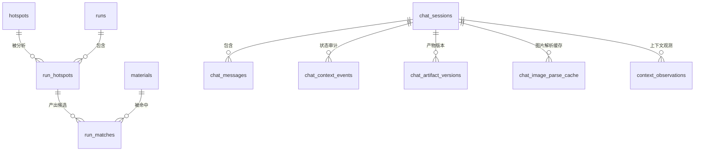

# 数据契约

> 本文档是**数据库结构与数据字典的唯一事实源**。代码（SQLAlchemy 模型、Alembic 迁移）向本契约对齐。
> 相关文档：API 契约见 `openapi.yaml`，检索算法参数见 `检索契约.md`，环境变量见 `配置契约.md`。

## 一、范围与原则

- 四类业务实体落库，共 **11 张表**：`materials`、`hotspots`、`runs`、`run_hotspots`、`run_matches`，对话侧 `chat_sessions`、`chat_messages`（S7.2），以及 E7 第六批新增的 `chat_context_events`、`chat_artifact_versions`、`chat_image_parse_cache`、`context_observations`（S7.24–S7.28）。
- 命名一律 snake_case；主键统一 `uuid`（默认 `gen_random_uuid()`）；时间戳统一 `timestamptz`（UTC）。
- **一次运行（run）覆盖一次提交的全部热点**，与 `docs/产品方案.md` §8.1"机会总览（一张表列出每个热点）"的口径一致。因此比初版计划的四张表多一张 `run_hotspots`，用来承载"批次 × 热点"的结果。
- 素材不做物理删除的业务语义；`data/materials/` 是唯一素材来源，库里是索引副本，素材文件消失时对应行由重新索引清理。
- **素材目录约定**：`data/materials/` 下允许任意主题子目录（如 `运动/`、`美食/`）；**上传落点固定为 `<YYYY-MM>/`**（如 `2026-10/`）；`_trash/` 是回收站目录——扫描时**跳过、不进库**，且保留原相对路径结构（移入即出库、恢复即反向移动，无需额外元数据）。
- **人工编辑的落点（S6.2）**：素材库页改标题 / 标签 / 描述时，**同时**写 `materials` 行与同名旁车
  `<素材文件名>.txt`（`标题: …` / `标签: a, b` / `描述: …`，UTF-8 + LF）——磁盘目录是唯一来源，
  重扫描必须得到同一份事实。已有 `.md` / `.json` 旁车时**不删原文件**，另写 `.txt`（`sidecar_path`
  的优先级是 `.txt` > `.md` > `.json`，所以 `.txt` 生效）。值没变时不写文件。
- **回收站（S6.3）**：移入回收站会把素材**连同它的旁车**一起移到 `_trash/<原相对路径>`，
  并删掉索引行（`run_matches` 靠外键 CASCADE 一起清掉，**历史候选不再回来**）；回收站里已有同名时
  自动加 `-2` 序号。恢复 = 反向移动 + 重新入库（**新 uuid**、重新打标）。

## 二、ER 图



关系说明：一次提交产生 1 条 `runs`；批次内每个热点产生 1 条 `run_hotspots`；每个热点选出若干候选，落到 `run_matches`；`materials` 是素材索引，可被多次命中。

对话侧（S7.2）：一个会话（`chat_sessions`）包含多条消息（`chat_messages`）；**对话表与
`runs` 各自独立**——一条消息可以不触发分析，一次分析也可以由非对话入口（`POST /api/analyze`）发起，
两者只通过 `chat_messages.run_id` 弱关联（不加外键，run 删除不影响历史消息）。

E7 第六批（S7.24–S7.28）：会话增加**结构化上下文状态**（`state_version` / `topic_id` /
`context_state` / `artifact_heads` / `recovery_status`），状态变更单独写 `chat_context_events`；
改稿与线索编辑落 `chat_artifact_versions`（不可变成功版本 + 请求认领）；原始图片解析落
`chat_image_parse_cache`（按内容身份复用）；度量事实落 `context_observations`。
四张新表都按 `session_id` 级联删除，会话删除即状态、版本、缓存与观测一起消失。**原始解析缓存是
缓存对象，业务线索是产物**——缓存 TTL 删除不影响 `chat_artifact_versions` 里的编辑版。

## 三、表结构

### 3.1 `materials` — 素材索引

| 字段 | 类型 | 可空 | 默认 | 说明 |
| --- | --- | --- | --- | --- |
| `id` | uuid | 否 | `gen_random_uuid()` | 主键 |
| `path` | text | 否 | — | 素材绝对路径，唯一 |
| `type` | text | 否 | `'video'` | `video` / `image` |
| `title` | text | 否 | `''` | 标题，来自旁车文件或模型打标 |
| `description` | text | 否 | `''` | 一句话描述 |
| `tags` | text[] | 否 | `'{}'` | 标签 |
| `elements` | jsonb | 否 | `'[]'` | 爆点要素数组，结构同 API 的 `Element` |
| `source` | text | 否 | `'filename'` | 打标来源：`sidecar` / `vision` / `filename` / `legacy` |
| `duration_s` | numeric(8,2) | 否 | `0` | 时长（视频），图片为 0 |
| `width` | integer | 否 | `0` | 宽 |
| `height` | integer | 否 | `0` | 高 |
| `has_audio` | boolean | 否 | `false` | 是否含音轨 |
| `size_bytes` | bigint | 否 | `0` | 文件大小 |
| `mtime` | timestamptz | 是 | — | 文件修改时间 |
| `keyframes` | jsonb | 否 | `'[]'` | 关键帧相对路径数组 |
| `fingerprint` | text | 是 | — | `mtime` + `size_bytes` 拼接，增量索引判断依据 |
| `embedding` | vector(1024) | 是 | — | 语义向量；未打标时为 NULL |
| `embedding_model` | text | 是 | — | 生成该向量的模型名，用于识别"换模型需重建" |
| `indexed_at` | timestamptz | 否 | `now()` | 本次索引时间 |

### 3.2 `hotspots` — 热点与线索

| 字段 | 类型 | 可空 | 默认 | 说明 |
| --- | --- | --- | --- | --- |
| `id` | uuid | 否 | `gen_random_uuid()` | 主键 |
| `raw_text` | text | 否 | — | 热点原文（用户输入，不做改写） |
| `clue` | jsonb | 否 | — | 线索快照，结构同 API 的 `HotspotClue` |
| `created_at` | timestamptz | 否 | `now()` | 首次分析时间 |

说明：`hotspots` 按原文去重复用——同一句热点再次提交时复用已有线索，避免重复付费（对应 `docs/产品方案.md` P1"历史运行回看"）。

**预置线索优先（S6.7）**：`POST /api/analyze` 带 `clues` 时以请求为准——非空的每一项会写进对应
`hotspots` 行的 `clue`（`hotspot_raw` 一律替换成该行的 `raw_text`），同一原文在这次请求里出现多次时
以**最后一条**为准；该热点随后走「复用已有线索」路径，**拆解节点短路、不再调模型**。
不传 `clues` 时行为与以前完全一致（复用库里已有的快照，不覆盖、不清空）。
**历史回看的影响**：`run_matches`、`run_hotspots.coverage`、`run_hotspots.draft` 保留运行当时的快照，
但 `GET /api/runs/{run_id}` 里展示的线索读的是 `hotspots.clue`，因此会跟着新值更新。

### 3.3 `runs` — 一次运行的批次信息

| 字段 | 类型 | 可空 | 默认 | 说明 |
| --- | --- | --- | --- | --- |
| `id` | uuid | 否 | `gen_random_uuid()` | 主键，即 API 的 `run_id` |
| `job_id` | text | 否 | — | 异步任务标识，唯一；API 的 `job_id` |
| `status` | text | 否 | `'queued'` | `queued` / `running` / `succeeded` / `failed` |
| `topk` | integer | 否 | `5` | 本批次检索的截断上限（1–20），来自 `POST /api/analyze` 的 `topk` |
| `request_id` | text | 是 | — | 提交请求的 `X-Request-ID`，便于按请求排障（S3.3 起写入） |
| `created_at` | timestamptz | 否 | `now()` | 入队时间 |
| `started_at` | timestamptz | 是 | — | 开始执行时间 |
| `finished_at` | timestamptz | 是 | — | 结束时间 |
| `llm_calls` | integer | 否 | `0` | 批次内模型调用次数 |
| `prompt_tokens` | integer | 否 | `0` | 输入 token 合计 |
| `completion_tokens` | integer | 否 | `0` | 输出 token 合计 |
| `cost_cny` | numeric(10,4) | 否 | `0` | 预估成本（人民币元）；模型按美元计价，由 `[llm]` 段配置的折算单价计算后入库 |
| `latency_ms` | integer | 否 | `0` | 总耗时（毫秒） |
| `prompt_versions` | jsonb | 否 | `'{}'` | 本次运行各任务实际使用的 prompt 版本，如 `{"hotspot_clue": 1}`；键为 task_id，定义见 `docs/contracts/prompt契约.md` §五 |
| `error` | text | 是 | — | 失败原因，仅 `failed` 时有值 |
| `stage` | jsonb | 否 | `'{}'` | 当前阶段快照（S7.20）：`{stage, label, status, started_at, updated_at, attempt, retries, error_category, last_finished_stage, run_id, job_id, source_id, stage_instance_id, source_seq, progress_revision, generation, nodes}`；`source_id` / `stage_instance_id` 由生产端绑定，`source_seq` 由来源端递增，不能按轮询到达顺序重编号；`progress_revision` 是轮次已接受快照版本。`nodes` 按 `(stage, attempt, run_id?, source_id?, stage_instance_id?)` 去重；同来源迟到只补历史、不接管当前，跨来源 / 跨执行由明确开始绑定后推进。 |

说明：`status` 是**批次级**口径——`failed` 表示本批次中**至少有一个热点失败**（`run_hotspots.status` 保留每个热点的细粒度状态，前端按它展示明细）。不设 `partial` 状态：引入它要同时改契约与前端联动，收益不抵成本。

### 3.4 `run_hotspots` — 批次 × 热点

| 字段 | 类型 | 可空 | 默认 | 说明 |
| --- | --- | --- | --- | --- |
| `id` | uuid | 否 | `gen_random_uuid()` | 主键 |
| `run_id` | uuid | 否 | — | 外键 → `runs.id`，级联删除 |
| `hotspot_id` | uuid | 否 | — | 外键 → `hotspots.id`，限制删除 |
| `position` | integer | 否 | — | 在本次提交中的顺序，从 1 开始 |
| `status` | text | 否 | `'queued'` | 单个热点的状态，枚举同 `runs.status` |
| `coverage` | jsonb | 否 | `'{}'` | 覆盖度快照，结构同 API 的 `Coverage` |
| `draft` | jsonb | 是 | — | 文案初稿快照，结构同 API 的 `Draft`；未撰稿时为 NULL |
| `error` | text | 是 | — | 该热点失败时的原因 |

### 3.5 `run_matches` — 候选素材与命中依据

| 字段 | 类型 | 可空 | 默认 | 说明 |
| --- | --- | --- | --- | --- |
| `run_hotspot_id` | uuid | 否 | — | 外键 → `run_hotspots.id`，级联删除 |
| `material_id` | uuid | 否 | — | 外键 → `materials.id`，级联删除 |
| `rank` | integer | 否 | — | 排名，从 1 开始 |
| `score` | numeric(6,4) | 否 | — | 最终得分，0–1 |
| `recall_sources` | text[] | 否 | `'{}'` | 召回来源：`literal` / `vector` |
| `hits` | jsonb | 否 | `'[]'` | 命中要素数组，结构同 API 的 `MatchHit` |
| `missing` | jsonb | 否 | `'[]'` | 未命中要素 |
| `reasons` | jsonb | 否 | `'[]'` | 相关理由，**不允许为空数组**（可解释性硬约束） |
| `usage` | text | 否 | `''` | 建议用法 |

主键：`(run_hotspot_id, material_id)`。

### 3.6 `chat_sessions` — 对话会话（S7.2）

| 字段 | 类型 | 可空 | 默认 | 说明 |
| --- | --- | --- | --- | --- |
| `id` | uuid | 否 | `gen_random_uuid()` | 主键，即 API 的 `session_id` |
| `title` | text | 否 | `''` | 会话标题，取**首条用户消息**去空白后的前 20 字（空消息则 `新对话`）；不可编辑 |
| `created_at` | timestamptz | 否 | `now()` | 建会话时间 |
| `updated_at` | timestamptz | 否 | `now()` | 最后一条消息落库时间；侧栏按它倒序 |
| `state_version` | integer | 否 | `0` | 上下文状态的单调版本（S7.24）；每次状态变更 +1，作为 CAS 条件与审计序号；旧会话为 0 |
| `topic_id` | text | 是 | — | 当前话题标识（S7.24）；新话题由 `reset_topic` 生成新的 `topic:<uuid>`，旧话题事实归档不删除 |
| `context_state` | jsonb | 否 | `'{}'` | 结构化快照（S7.24）：`{facts: [...], proposals: [...], object_refs: [...], archived: [...]}`，元素结构见 §3.8 |
| `artifact_heads` | jsonb | 否 | `'{}'` | 产物对象 → 当前成功版本（S7.25）：`{object_key: {version_id, version_no, updated_at}}`；**只由版本服务在同一事务内更新** |
| `recovery_status` | text | 否 | `'complete'` | 旧会话恢复状态（S7.24）：`complete` / `partial`；`partial` 时前端显示「历史状态未完整恢复」 |

### 3.7 `chat_messages` — 对话消息（S7.2）

| 字段 | 类型 | 可空 | 默认 | 说明 |
| --- | --- | --- | --- | --- |
| `id` | uuid | 否 | `gen_random_uuid()` | 主键，即 API 的 `message_id` |
| `session_id` | uuid | 否 | — | 外键 → `chat_sessions.id`，级联删除 |
| `role` | text | 否 | — | `user` / `assistant`（工具过程不单独建行，挂在 assistant 的 `tool_calls` 上） |
| `content` | text | 否 | `''` | 消息正文；`running` 的 assistant 行为空串 |
| `status` | text | 否 | `'succeeded'` | `running` / `succeeded` / `failed` / `interrupted`（用户消息恒为 `succeeded`） |
| `attachments` | jsonb | 否 | `'[]'` | 附件数组，元素 `{kind, name, mime, bytes, path}`；`path` 是相对工程根的正斜杠路径（落 `runs/_chat/<session_id>/`）。**一条消息最多 9 张（S7.14），同属一组**：多图合成一场解析、跨轮回落也按整组 |
| `tool_calls` | jsonb | 否 | `'[]'` | 本轮工具调用过程，元素 `{tool, status, args, call_id, attempt, stage_key, run_id, cost_cny, prompt_tokens, completion_tokens, usage_status, latency_ms, error, steps}`；`status` 可为 `succeeded` / `failed` / `interrupted`，工具内部已完成的子步骤可与外层 `interrupted` 同时保存。`usage_status` = `actual` / `estimated` / `unknown` / `cached`，缓存命中为 `cached` 且用量清零；`attempt` 是工具调用次数，与 worker 阶段尝试号分层。 |
| `prompt_versions` | jsonb | 否 | `'{}'` | 本轮对话实际使用的 prompt 版本（如 `{"chat_supervisor": 1}`），口径同 `runs.prompt_versions` |
| `run_id` | uuid | 是 | — | 本轮分析工具产出的运行 id（**不加外键**：run 删除不影响历史消息） |
| `turn_id` | uuid | 是 | — | 本轮对话的标识（S7.21，**不加外键**）；旧行为 NULL |
| `trace_id` | text | 是 | — | 本轮的 Langfuse trace id（S7.21）；追踪关闭或旧行为 NULL |
| `progress` | jsonb | 否 | `'{}'` | 当前阶段快照（S7.21），结构与 `runs.stage` 相同；刷新后据此恢复阶段，仅阶段语义变化时更新 |
| `cost_cny` | numeric(10,4) | 否 | `0` | 本轮成本 = supervisor 各次调用 + 各工具内部模型调用（拆解 / 改写 / **图片解析**）+ 分析那次 `runs.cost_cny`（S7.10 起图片解析按 `[vision].price_*` 计入，S6.6 的「不计成本」临时口径作废） |
| `prompt_tokens` | integer | 否 | `0` | 本轮输入侧用量，口径同 `cost_cny`（S7.10） |
| `completion_tokens` | integer | 否 | `0` | 本轮输出侧用量，口径同 `cost_cny`（S7.10） |
| `latency_ms` | integer | 否 | `0` | 本轮耗时（毫秒） |
| `error` | text | 是 | — | 失败/中断原因，仅 `failed` / `interrupted` 有值 |
| `created_at` | timestamptz | 否 | `now()` | 落库时间（同一会话内按它升序即对话顺序） |

说明：`status=running` 的 assistant 行代表"这一轮还没跑完"，前端刷新后用轮询补齐；API 进程重启
遗留的 `running` 行在下次读会话时按 `[chat].turn_stale_seconds` 标成 `interrupted`。
**陈旧判定按最近活跃时间（R3 / OBS-11；R5 / E7OBS2-06 加固）**：后台任务周期**原子续约**
快照的 `updated_at`（间隔为 `turn_stale_seconds` 的 1/5，夹在 10–60 秒；只前滚该一个键，
**不重写整份快照**，并发时覆盖不了刚写入的新阶段 / 终态；行条件带 `status='running'` 与
`turn_id` 身份，终态之后续约自然 0 行），判定取 `COALESCE(progress->>'updated_at', created_at)`
——活跃长轮次不会被误判，旧行（无快照）回落创建时间。**收尾是 CAS**：对账判定只算候选，
真正写回的 UPDATE 里**再查一次** `status` 与最近活跃时间，按受影响行数认定结果——主流程刚
成功 / 刚续约的行不会被旧判定覆盖（`interrupted` 计数也只算真正改到的行）。
阶段快照（`progress`）与消息行同一生命周期：读会话时被标 `interrupted` 的行，快照状态一并标
`interrupted`（类别 `timeout`，S7.21），不新增过期配置。

**终态与阶段的对应口径**（S7.22 补，R2 / R5）：失败轮次的消息为 `failed`，快照里**真实失败阶段**
终结为 `failed`（`error_category` 记安全类别），**不出现 `final_reply`**；被取消 / 进程中断的
轮次消息为 `interrupted`，快照当前阶段与消息同步终结为 `interrupted`（类别 `cancelled` 或
`timeout`）——模型决策在途时被取消，阶段直接投影 `interrupted/cancelled`（不再先发 `failed`
再被外层改写），**既有历史失败节点保留**。`final_reply`（整理回复）只出现在成功轮次，覆盖
**写库与终态整理**区间——它**不代表回复生成耗时**；生成区间看对应 supervisor 尝试
（流式包含在该次模型调用内）。

**阶段身份与单调合并（R5 / E7OBS2-02 / 03；E7OBS4-03）**：快照顶层 `run_id` / `job_id` 是**
当前阶段所属执行**的身份——切到新阶段时按事件身份重置，事件没带身份就清空（同一阶段内保留该阶段已知身份）。
两侧都有明确 `run_id` 且不一致时属于**不同执行**：迟到的旧执行终态**只补 `nodes` 历史事实，
绝不改顶层当前状态**；同一执行同一 `attempt` 出现与首个终态不同的第二个终态时**保留首个**
（同状态重复上报允许刷新 `latency_ms`）。

E7OBS4-03 把身份拆成三层并**先裁决、后更新**：

| 字段 | 语义 |
| --- | --- |
| `source_id` | 产生事件的执行来源（`worker:<run_id>:g<代次>` / `chat:<turn_id>`） |
| `stage_instance_id` | 来源内的一次阶段实例（同一阶段名的新一次执行是**另一个实例**，默认 `source:stage`，worker 侧带序号） |
| `source_seq` | 来源生产端递增顺序号，只在**同一来源**内比较；换来源时按新来源的序号起步，不取跨来源 `max` |
| `generation` | worker 执行代次（投递重试号）；旧代次的迟到写入只补历史或被存储层拒绝 |
| `progress_revision` | 轮次**已接受快照**的语义版本，前端只在同一 `(message_id, turn_id)` 范围内比较 |

裁决规则：同来源旧序号 / 旧代次 → 只补历史；同一实例重复开始不重置计时、已终结实例不重开；
同名阶段的**不同实例**允许启动（旧实例的终态不阻断）；冲突终态保留首个。消息级
`progress_revision` 与 `source_seq` 是两件事，不能互相代用。

**SSE 事件的权威快照（E7OBS4-04）**：`stage`、需要更新阶段的 `tool_progress` / `tool_finished`、
以及成功 / 失败 / 取消的终端事件，除原始阶段字段外还带 **合并后的 `progress`** 与
`progress_revision`，事件信封带 `message_id` / `turn_id`。前端取得 `progress` 后**只投影一次**，
不再用原始 `stage_key` 自拼状态；原始 `stage` / `done` / `total` 仅用于工具过程列表。
旧格式（无 `progress`）按旧合并规则兼容，但**不能覆盖**已有 `progress_revision` 的新格式事实。

对话侧的结构化去重键包含 `run_id` / `job_id`、来源身份（`source_id` / `stage_instance_id` /
`source_seq` / `generation`）与终态耗时；`tool_finished` 用 worker 的尝试号 / 重试号 / 最后状态
收尾，不用工具调用次数覆盖。

### 3.8 `chat_context_events` — 上下文状态审计（S7.24）

| 字段 | 类型 | 可空 | 默认 | 说明 |
| --- | --- | --- | --- | --- |
| `id` | uuid | 否 | `gen_random_uuid()` | 主键 |
| `session_id` | uuid | 否 | — | 外键 → `chat_sessions.id`，级联删除 |
| `state_version` | integer | 否 | — | 本次变更后的会话状态版本；**同一会话内唯一**，即 CAS 的序号 |
| `event_type` | text | 否 | — | `delta` / `confirm` / `reject` / `retract` / `replace` / `reset_topic` / `recovery` |
| `actor` | text | 否 | — | `extract`（模型抽取经服务端验证后应用）/ `user`（用户动作）/ `system`（恢复与维护） |
| `source_ref` | jsonb | 否 | `'{}'` | 来源：`{message_id, action_id, turn_id}`；模型来源**必须**落到真实用户消息 ID |
| `decisions` | jsonb | 否 | `'[]'` | 逐事实裁决：`[{fact_id, kind, decision, reason}]`，`decision` ∈ `applied` / `pending_confirmation` / `rejected` / `superseded` / `retracted` |
| `delta` | jsonb | 否 | `'{}'` | 本次提交的原始增量（已通过证据校验的部分），供复算与排障 |
| `reason` | text | 否 | `''` | 安全原因（拒绝 / 冲突 / 歧义），不含用户原文 |
| `created_at` | timestamptz | 否 | `now()` | 事务时间 |

事实与提案的结构（存在 `chat_sessions.context_state` 里，元素形状固定）：

```text
fact = {
  fact_id, kind, value, scope, scope_id, status, source_ref, evidence,
  created_version, replaces, updated_at
}
proposal = {fact_id, kind, value, scope, scope_id, reason, source_ref, evidence,
            created_version, conflicts_with[]}
```

- `kind` ∈ `goal` / `constraint` / `preference` / `audience` / `format`；
- `status` ∈ `active` / `pending_confirmation` / `superseded` / `retracted`；
- `scope` ∈ `session` / `topic` / `artifact`（`artifact` 未解析对象时不得激活）；
- `evidence` 必须是**本轮用户原文的真实片段**，`source_ref.message_id` 必须是本会话真实消息；
- `replaces` 指向被显式替换的旧 `fact_id`；被替换项转 `superseded`，保留历史。

### 3.9 `chat_artifact_versions` — 文案/线索版本（S7.25）

| 字段 | 类型 | 可空 | 默认 | 说明 |
| --- | --- | --- | --- | --- |
| `id` | uuid | 否 | `gen_random_uuid()` | 主键，即 API 的 `version_id` |
| `session_id` | uuid | 否 | — | 外键 → `chat_sessions.id`，级联删除 |
| `object_key` | text | 否 | — | 对象键：`draft:<run_id>:<position>` / `clue:<run_id>:<position>` |
| `object_type` | text | 否 | — | `draft` / `clue` |
| `run_id` | uuid | 是 | — | 关联运行（不加外键：run 删除不动产物历史） |
| `hotspot_position` | integer | 是 | — | 该运行里的第几条热点（从 1 起） |
| `request_key` | text | 否 | — | 请求认领键（`sha256(session|object_key|turn_id|tool_call_id|request)`）；**会话内唯一** |
| `status` | text | 否 | `'pending'` | `pending` / `succeeded` / `failed` / `refused` / `interrupted`；只有 `succeeded` 分配 `version_no` |
| `version_no` | integer | 是 | — | 成功版本号，从 1 起单调递增；**同对象内唯一**（部分唯一索引） |
| `base_version_id` | uuid | 是 | — | 实际基础版本；首个版本为 NULL（基础是运行初稿快照）；必须属于同会话同对象 |
| `content` | jsonb | 是 | — | 不可变内容：文案对象是 `Draft` 结构；线索对象是 `{clue, edited_fields}` |
| `source` | jsonb | 否 | `'{}'` | `{turn_id, message_id, tool_call_id, actor}` |
| `prompt_versions` | jsonb | 否 | `'{}'` | 本次生成用到的 prompt 版本 |
| `usage` | jsonb | 否 | `'{}'` | `{cost_cny, prompt_tokens, completion_tokens, usage_status}` |
| `error` | text | 是 | — | 失败 / 拒绝原因（安全文案） |
| `created_at` | timestamptz | 否 | `now()` | 认领时间 |
| `updated_at` | timestamptz | 否 | `now()` | 终态时间 |

口径：

1. **请求先认领再付费**：认领行先提交（`status=pending`），再发模型调用；重放同一 `request_key`
   返回既有结果或「处理中」，不再发第二次调用；失败重试使用**新的** `request_key` 并关联原请求。
2. **成功版本不可变**：`version_no` 与 `content` 一旦写入不再修改；head 只在会话行的
   `artifact_heads` 与成功提交的**同一事务**内切换。
3. 运行初稿（`run_hotspots.draft`）登记为对象首个成功版本（`base_version_id` 为 NULL），
   **原快照不变**；改稿不写回 `run_hotspots`。

### 3.10 `chat_image_parse_cache` — 图片解析持久缓存（S7.27）

| 字段 | 类型 | 可空 | 默认 | 说明 |
| --- | --- | --- | --- | --- |
| `id` | uuid | 否 | `gen_random_uuid()` | 主键 |
| `session_id` | uuid | 否 | — | 外键 → `chat_sessions.id`，级联删除 |
| `cache_key` | text | 否 | — | `sha256(identity 规范化 JSON)`；会话内唯一 |
| `identity` | jsonb | 否 | — | 完整身份：`{image_digests[], provider, base_url, model, params_digest, prompt_digest, prompt_version, schema_version}` |
| `payload` | jsonb | 否 | — | 成功解析：`{clue, raw_text, prompt_versions}` |
| `source` | jsonb | 否 | `'{}'` | 产生该条目的轮次与消息：`{turn_id, message_id, order}` |
| `created_at` | timestamptz | 否 | `now()` | 创建时间（TTL 起点，命中不续期） |
| `expires_at` | timestamptz | 否 | — | `created_at + [context].image_cache_ttl_days`（默认 7 天） |

失败、取消、部分解析**不写成功缓存**；同键并发首次 miss 允许真实调用各付一次，唯一约束只保留
一个有效条目（`ON CONFLICT DO NOTHING` 后重读）。

### 3.11 `context_observations` — 上下文与缓存度量事实源（S7.28）

| 字段 | 类型 | 可空 | 默认 | 说明 |
| --- | --- | --- | --- | --- |
| `event_id` | text | 否 | — | 稳定事件 ID（`sha256` 派生，同一事实重复投递幂等）；主键 |
| `session_id` | uuid | 否 | — | 外键 → `chat_sessions.id`，级联删除 |
| `event_type` | text | 否 | — | `context_state_decision` / `context_assembled` / `artifact_version_committed` / `cache_lookup_finished` / `artifact_consumed` / `model_attempt_finished` |
| `turn_id` | text | 是 | — | 关联轮次 |
| `call_id` | text | 是 | — | 关联调用（工具 call_id / 逻辑调用 ID） |
| `attempt` | integer | 是 | — | 实际传输序号（重试每次一行） |
| `model` | text | 是 | — | 模型名 |
| `prompt_version` | text | 是 | — | prompt 标识（`task:vN`） |
| `policy_version` | text | 是 | — | 策略版本（上下文模式 + 缓存 schema 版本） |
| `payload` | jsonb | 否 | `'{}'` | 结构化事实（估算分项、H/M/E/B、缓存分项、TTFT、耗时等）；**不放用户原文、图片、工具参数正文与素材路径** |
| `created_at` | timestamptz | 否 | `now()` | 事件时间 |

`event_id` 由 `event_type + session_id + 业务键 + 关键区分字段` 派生；同一 ID 重复写入按主键冲突
忽略（`ON CONFLICT DO NOTHING`），不重复计数。观测是**旁路**：写入失败只告警，不阻断业务。

## 四、索引与约束

### 4.1 索引

| 表 | 索引 | 类型 | 用途 |
| --- | --- | --- | --- |
| `materials` | `(path)` | 唯一 B-tree | 素材唯一性 |
| `materials` | `(fingerprint)` | B-tree | 增量索引判断 |
| `materials` | `(tags)` | GIN | 标签检索 |
| `materials` | `(coalesce(title,'') \|\| ' ' \|\| coalesce(description,''))` | GIN `gin_trgm_ops` | 字面召回的预留索引：当前实现用 `word_similarity` 逐行聚合，**不走此索引**；保留给「逐关键词 `<%` 操作符」的写法（ADR 0010） |
| `materials` | `(embedding)` | HNSW `vector_cosine_ops`，`m=16`、`ef_construction=64` | 向量召回 |
| `materials` | `(indexed_at)` | B-tree | 增量与运维查询 |
| `hotspots` | `(created_at)` | B-tree | 历史回看 |
| `runs` | `(job_id)` | 唯一 B-tree | 任务查询 |
| `runs` | `(status)`、`(created_at)` | B-tree | 状态筛选与列表 |
| `run_hotspots` | `(run_id, position)` | 唯一 B-tree | 批次内顺序与幂等 |
| `run_hotspots` | `(hotspot_id)` | B-tree | 按热点回看历史 |
| `run_matches` | `(run_hotspot_id, rank)` | 唯一 B-tree | 排名稳定与幂等 |
| `run_matches` | `(material_id)` | B-tree | 素材复用统计 |
| `chat_sessions` | `(updated_at)` | B-tree | 侧栏按最近活跃倒序（Postgres 反向扫描即可） |
| `chat_messages` | `(session_id, created_at)` | B-tree | 按会话读历史（对话顺序） |
| `chat_context_events` | `(session_id, state_version)` | 唯一 B-tree | 状态版本唯一 + 审计回放（S7.24） |
| `chat_context_events` | `(session_id, created_at)` | B-tree | 会话审计时间线 |
| `chat_artifact_versions` | `(session_id, request_key)` | 唯一 B-tree | 请求认领与重放（S7.25） |
| `chat_artifact_versions` | `(session_id, object_key, version_no)` | 唯一 B-tree（部分，`status='succeeded'`） | 成功版本号不重复；失败记录不占号 |
| `chat_artifact_versions` | `(session_id, object_key, version_no DESC)` | B-tree | 列版本与读最近成功版 |
| `chat_image_parse_cache` | `(session_id, cache_key)` | 唯一 B-tree | 缓存身份唯一（S7.27） |
| `chat_image_parse_cache` | `(expires_at)` | B-tree | 到期清理 |
| `context_observations` | `(event_id)` | 主键 | 幂等投递（S7.28） |
| `context_observations` | `(session_id, created_at)` | B-tree | 按会话导出与 30 日清理 |
| `context_observations` | `(event_type, created_at)` | B-tree | 报告按事件类型聚合 |

### 4.2 约束

| 表 | 约束 |
| --- | --- |
| `materials` | `type` ∈ (`video`,`image`)；`source` ∈ (`sidecar`,`vision`,`filename`,`legacy`)；`width`/`height`/`size_bytes` ≥ 0 |
| `runs` | `status` ∈ (`queued`,`running`,`succeeded`,`failed`)；`cost_cny` ≥ 0；`topk` ∈ [1,20] |
| `run_hotspots` | `position` ≥ 1；`(run_id, position)` 唯一 |
| `run_matches` | `rank` ≥ 1；`score` ∈ [0,1]；`reasons` 长度 ≥ 1 |
| `chat_messages` | `role` ∈ (`user`,`assistant`)；`status` ∈ (`running`,`succeeded`,`failed`,`interrupted`)；`cost_cny` ≥ 0；`latency_ms` ≥ 0；`prompt_tokens` ≥ 0；`completion_tokens` ≥ 0 |
| `chat_sessions` | `state_version` ≥ 0；`recovery_status` ∈ (`complete`,`partial`) |
| `chat_context_events` | `state_version` ≥ 0；`event_type` ∈ 七类；`actor` ∈ (`extract`,`user`,`system`) |
| `chat_artifact_versions` | `status` ∈ (`pending`,`succeeded`,`failed`,`refused`,`interrupted`)；`version_no` 仅 `succeeded` 非空且 ≥ 1；`object_type` ∈ (`draft`,`clue`)；`base_version_id` 不得指向自身 |
| `chat_image_parse_cache` | `expires_at` > `created_at` |
| `context_observations` | `event_type` ∈ 六类；`attempt` 为空或 ≥ 1 |

**级联规则**：`run_hotspots.run_id`、`run_matches.run_hotspot_id`、`run_matches.material_id`、
`chat_messages.session_id`、`chat_context_events.session_id`、`chat_artifact_versions.session_id`、
`chat_image_parse_cache.session_id`、`context_observations.session_id` 均为 `ON DELETE CASCADE`；
`run_hotspots.hotspot_id → hotspots.id` 为 `ON DELETE RESTRICT`，防止误删仍在被引用的热点线索。
`chat_messages.run_id`、`chat_artifact_versions.run_id` **不是外键**。

## 五、枚举值

| 枚举 | 取值 | 权威出处 |
| --- | --- | --- |
| 运行状态 / 单热点状态 | `queued`、`running`、`succeeded`、`failed` | 本契约 |
| 素材类型 | `video`、`image` | 本契约 |
| 打标来源 | `sidecar`、`vision`、`filename`、`legacy` | 本契约 |
| 爆点要素类型 | `ip`、`topic`、`scene`、`visual`、`emotion`、`sound`、`conflict`、`format`、`audience` | `docs/产品方案.md` 第六节 |
| 召回来源 | `literal`、`vector` | `检索契约.md` |
| 对话消息角色 | `user`、`assistant` | 本契约 |
| 对话消息状态 | `running`、`succeeded`、`failed`、`interrupted` | 本契约 |
| 阶段状态（阶段快照） | `running`、`succeeded`、`failed`、`skipped`、`interrupted` | 本契约（S7.20 / S7.21） |
| 安全错误类别 | `llm_error`、`embedding_error`、`schema_error`、`config_error`、`timeout`、`cancelled`、`dependency_unavailable`、`internal`、`required_context_overflow`、`history_group_broken`、`state_version_conflict`、`artifact_version_mismatch`、`cache_stale_or_invalid` | 本契约（S7.20 / S7.26 / S7.27）；只进日志 / 快照 / 追踪元数据，不含错误正文 |
| 事实类型 | `goal`、`constraint`、`preference`、`audience`、`format` | 本契约（S7.24） |
| 事实状态 | `active`、`pending_confirmation`、`superseded`、`retracted` | 本契约（S7.24） |
| 事实作用域 | `session`、`topic`、`artifact` | 本契约（S7.24） |
| 上下文动作 | `confirm`、`reject`、`retract`、`replace`、`reset_topic` | 本契约（S7.24） |
| 产物版本状态 | `pending`、`succeeded`、`failed`、`refused`、`interrupted` | 本契约（S7.25） |
| 缓存查询结论 | `hit`、`miss`、`error`、`bypass` | 本契约（S7.27） |
| 失败分类（上下文） | `constraint_missing`、`constraint_conflict`、`unsupported_inference`、`scope_mismatch`、`artifact_version_mismatch`、`state_version_conflict`、`history_group_broken`、`required_context_overflow`、`evidence_unavailable`、`cache_stale_or_invalid`、`measurement_incomplete` | `docs/E7第六批 · 上下文可靠性与缓存度量可执行方案.md` §3.2 |

要素类型的准确定义（含默认权重与"可迁移 / 不可直用"分层）以 `docs/产品方案.md` 第六节为准，本契约只复述取值，不重复定义。

## 六、迁移策略（Alembic）

- **首个迁移**按顺序执行：`CREATE EXTENSION IF NOT EXISTS vector` → `CREATE EXTENSION IF NOT EXISTS pg_trgm` → 建 5 张表 → 建索引与约束 → 建 HNSW 索引。后续迁移（`0002` prompt_versions、`0003` runs 的 topk / request_id、`0004` 对话两表、`0005` 对话消息的 `prompt_tokens` / `completion_tokens`、`0006` runs 的阶段快照 `stage`、`0007` 对话消息的 `turn_id` / `trace_id` / `progress`、`0008` 上下文状态与产物版本四表 + `chat_sessions` 五个新列）在此基础上叠加，全部可回滚；删列迁移的 downgrade 只回滚 schema，快照数据不可恢复（迁移 docstring 如实说明）。
- 扩展（extension）需要数据库超级用户权限，因此由 `docker-compose` 的 Postgres 初始化脚本预先创建，迁移脚本里用 `IF NOT EXISTS` 兜底。
- **downgrade 只删除表与索引，不 `DROP EXTENSION`**——扩展是同库共享资源，删掉可能影响同库其它 schema。
- 迁移文件命名：`<revision>_<snake_case 描述>.py`，描述用英文（避免跨平台文件名问题），说明写进迁移文件的 docstring（中文）。
- 任何 schema 变更都必须走迁移脚本，禁止手工改库（该规则已写入 `docs/开发规范.md`）。
- pgvector 版本要求 **≥ 0.5.0**（HNSW 索引自该版本起提供），compose 镜像需固定到满足该版本的具体 tag，不用 `latest`。

## 七、与现有代码的映射

现有 `src/xhs_agent/schemas.py` 定义的是**内存契约**（dataclass），本契约定义的是**持久化契约**。P1 阶段把 dataclass 升级为 Pydantic v2 模型后，两者的对应关系如下：

| 内存结构（schemas.py） | 落库位置 |
| --- | --- |
| `Material` | `materials` 表 |
| `Element` | `materials.elements`、`hotspots.clue.elements` 内的数组元素 |
| `HotspotClue` | `hotspots.clue` |
| `Coverage` | `run_hotspots.coverage` |
| `MatchCandidate` | `run_matches` 行 + 关联的 `materials` 行 |
| `Draft` | `run_hotspots.draft` |

移植时的口径要求：字段名改为 snake_case 后保持一致，不新增语义；`MatchCandidate.reasons` 的非空约束要在 Pydantic 模型与数据库约束两处都体现。

## 八、变更规则

1. 本契约是唯一事实源；改表结构必须先改本文件，再写 Alembic 迁移。
2. 破坏性变更（删列、改类型、改枚举取值、改主键）必须在 `docs/adr/` 补一条 ADR，说明迁移与回滚方案。
3. 每次迁移提交后，同步更新本文件的字段表与索引表；两者不一致视为未完成。
